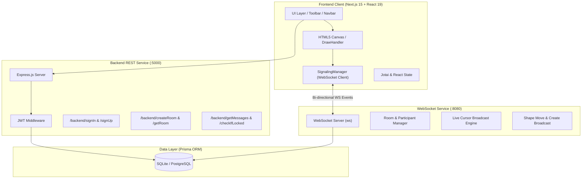

<div align="center">

# 🎨 OneDraw

### *Next-Gen Real-Time Collaborative Whiteboard & Vector Design Engine*

[](https://github.com/SatvikPy)
[](https://github.com/SatvikPy/OneDraw/stargazers)
[](LICENSE)
[](https://nextjs.org/)
[](https://reactjs.org/)
[](https://www.typescriptlang.org/)
[](https://nodejs.org/)
[](https://www.prisma.io/)
[](https://tailwindcss.com/)

[**Explore Demo**](http://localhost:3000) • [**Report Bug**](https://github.com/SatvikPy/OneDraw/issues) • [**Request Feature**](https://github.com/SatvikPy/OneDraw/issues) • [**Connect on GitHub**](https://github.com/SatvikPy)

---

</div>

## 📖 Overview

**OneDraw** is a high-performance, real-time collaborative whiteboard and vector designing suite designed for seamless visual brainstorming, architectural diagramming, prototyping, and team sketching. 

Engineered with a **Next.js 15 App Router** frontend, a **Node.js/Express REST API**, and a dedicated **high-throughput WebSocket server**, OneDraw enables ultra-low-latency real-time multi-user interaction with live cursor synchronization, shape locking, and persistent state management.

---

## ✨ Key Features

### 🖌️ Creative Toolkit
- **Vector & Freehand Drawing**: Smooth brush, pen, pencil, rectangle, circle/ellipse, line, and arrow tools.
- **Custom Styling & Palettes**: Dynamic color picker, hex presets, custom stroke widths, opacity, and fill options.
- **Shape Manipulation & Dragging**: Move, resize, and reposition canvas elements seamlessly.
- **Undo / Redo History**: Complete state history tracking for uninterrupted creative flow.

### ⚡ Real-Time Collaboration
- **Sub-millisecond WebSocket Sync**: Real-time broadcast of drawing actions across all connected clients.
- **Live User Presence & Cursors**: See collaborators' names, live cursor pointers, and hover focus in real-time.
- **Shape Locking & Conflict Resolution**: Automatic temporal locking mechanism (`lockedBy`, `lockExpire`) prevents conflicting simultaneous edits on the same vector element.
- **Instant Room Generation & Sharing**: Shareable room links with one-click clipboard copy.

### 🔐 Security & Persistence
- **JWT-Based Authentication**: Secure sign-up, sign-in, and token-verified WebSocket handshakes.
- **Type-Safe ORM Persistence**: Powered by Prisma ORM supporting SQLite for effortless local dev and PostgreSQL for production scale.
- **Zod Data Validation**: Robust schema validation on all incoming API payloads.

---

## 🏗️ System Architecture



---

## 📂 Repository Structure

```
OneDraw/
├── Frontend/                 # Next.js 15 frontend application
│   ├── app/                  # App router pages (Landing, Signin, Signup, Whiteboard/[roomId])
│   ├── Classes/              # Canvas engine (DrawHandler, OfflineDrawHandler, SignalingManager)
│   ├── Components/           # UI components (Navbar, ToolBar, Whiteboard, ColorDrawer, Participants)
│   ├── store/                # Jotai / React state atoms
│   └── utils/                # API helpers (getShapes, userFetcher)
├── backend/                  # Node.js + Express REST API
│   ├── prisma/               # Prisma schema & migration files
│   └── src/                  # Controllers, JWT middleware, routes & schemas
├── WsServer/                 # Standalone WebSocket synchronization server
│   ├── prisma/               # Shared Prisma schema
│   └── src/                  # WebSocket connection, room broadcasting & cursor engine
├── manifests/                # Kubernetes deployment manifests
├── buildspec.yml             # AWS CodeBuild / ECR CI/CD pipeline
└── package.json              # Workspace root scripts
```

---

## 🚀 Quickstart Guide

### Prerequisites
- [Node.js](https://nodejs.org/) (v18.0.0 or higher recommended)
- [npm](https://www.npmjs.com/) (v9.0.0 or higher)
- [Git](https://git-scm.com/)

---

### 1. Clone the Repository
```bash
git clone https://github.com/SatvikPy/OneDraw.git
cd OneDraw
```

---

### 2. Configure Environment Variables

Create the local environment files for each service:

#### Backend (`backend/.env`):
```env
DATABASE_URL="file:../../dev.db"
PORT=5000
FRONTEND_URL="http://localhost:3000"
```

#### WebSocket Server (`WsServer/.env`):
```env
DATABASE_URL="file:../../dev.db"
PORT=8080
```

#### Frontend (`Frontend/.env.local`):
```env
NEXT_PUBLIC_BACKEND_URL="http://localhost:5000/backend"
NEXT_PUBLIC_WEBSOCKET_SERVER_URL="ws://localhost:8080"
```

---

### 3. Install Dependencies & Initialize Database

#### Step A: Backend
```bash
cd backend
npm install
npx prisma db push
cd ..
```

#### Step B: WebSocket Server
```bash
cd WsServer
npm install
npx prisma generate
cd ..
```

#### Step C: Frontend
```bash
cd Frontend
npm install --legacy-peer-deps
cd ..
```

---

### 4. Start the Application

You can start each service in separate terminal tabs:

```bash
# Terminal 1 - Backend API (Port 5000)
npm run dev:backend

# Terminal 2 - WebSocket Server (Port 8080)
npm run dev:ws

# Terminal 3 - Frontend Web App (Port 3000)
npm run dev:frontend
```

Open **[http://localhost:3000](http://localhost:3000)** in your browser to start drawing and collaborating!

---

## 📡 API & WebSocket Protocols

### REST Endpoints (`http://localhost:5000/backend`)

| Method | Endpoint | Description | Auth Required |
| :--- | :--- | :--- | :--- |
| `POST` | `/signUp` | Register a new user account | No |
| `POST` | `/signIn` | Authenticate user & receive JWT token | No |
| `GET` | `/getUser/:userId` | Fetch user profile details | No |
| `POST` | `/getUsers` | Batch query user details by ID array | No |
| `POST` | `/createRoom` | Create or retrieve user whiteboard room | **Yes** (Bearer Token) |
| `GET` | `/getRoom/:slug` | Retrieve room metadata by slug identifier | No |
| `GET` | `/getMessages/:roomId` | Load persistent canvas shapes for a room | No |
| `GET` | `/checkIfLocked/:shapeId` | Check and claim temporary lock on a shape | **Yes** (Bearer Token) |

---

### WebSocket Message Protocol (`ws://localhost:8080?token=<JWT>`)

```json
// Join Room
{ "type": "joinRoom", "roomId": "room-uuid" }

// Draw / Create Shape
{ "type": "msg", "roomID": "room-uuid", "shape": { "id": "uuid", "type": "rect", "x": 100, "y": 100, ... } }

// Move / Update Existing Shape
{ "type": "move", "roomID": "room-uuid", "shape": { "id": "uuid", "x": 150, "y": 120 } }

// Live Cursor Synchronization
{ "type": "cursorMove", "roomId": "room-uuid", "x": 420, "y": 280 }

// Leave Room
{ "type": "leaveRoom", "roomId": "room-uuid" }
```

---

## 🐳 Containerization & Deployment

Each service contains a dedicated `Dockerfile` for containerized environments:

```bash
# Build Frontend
docker build -t onedraw-frontend ./Frontend

# Build Backend
docker build -t onedraw-backend ./backend

# Build WebSocket Server
docker build -t onedraw-ws ./WsServer
```

Kubernetes manifests are ready in the [`manifests/`](./manifests) directory for deployment to AWS EKS or standard K8s clusters.

---

## 🤝 Contributing

Contributions, issues, and feature requests are welcome!

1. Fork the Project
2. Create your Feature Branch (`git checkout -b feature/AmazingFeature`)
3. Commit your Changes (`git commit -m 'feat: Add AmazingFeature'`)
4. Push to the Branch (`git push origin feature/AmazingFeature`)
5. Open a Pull Request

---

## 📄 License

Distributed under the **MIT License**. See [`LICENSE`](LICENSE) for more information.

---

## 👨‍💻 Author & Maintainer

<div align="center">

### **Satvik Sharma**
*Full-Stack Engineer & Open Source Developer*

[](https://github.com/SatvikPy)
[](mailto:satviksharma.bpl@gmail.com)

*Made with ❤️ by Satvik Sharma*

</div>
